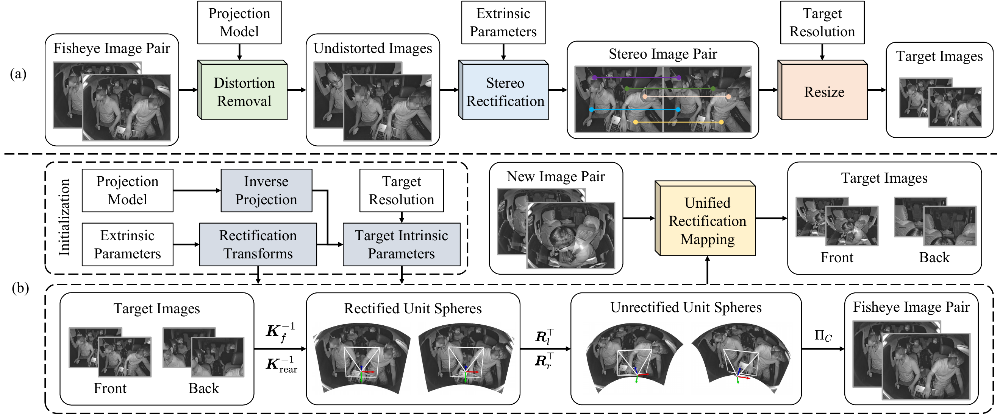
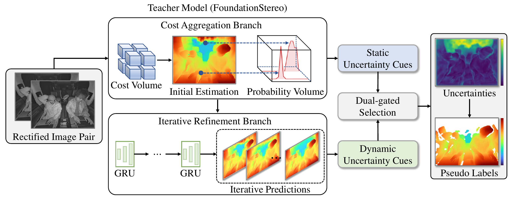
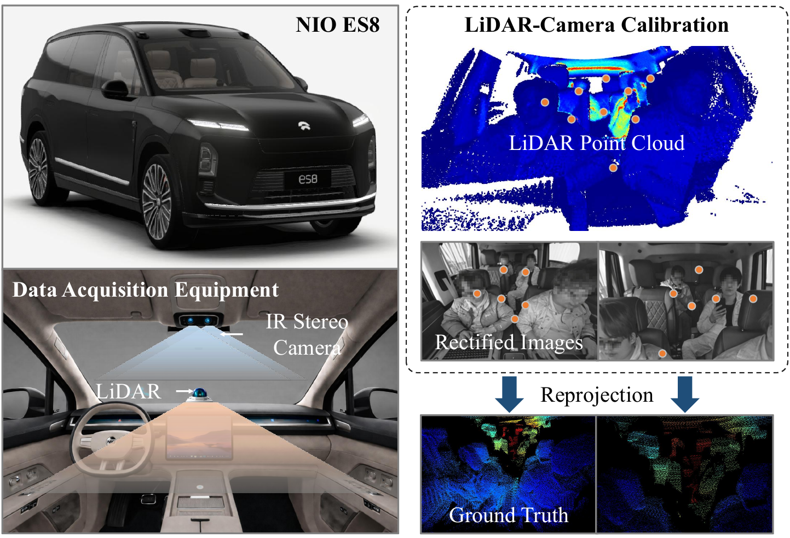
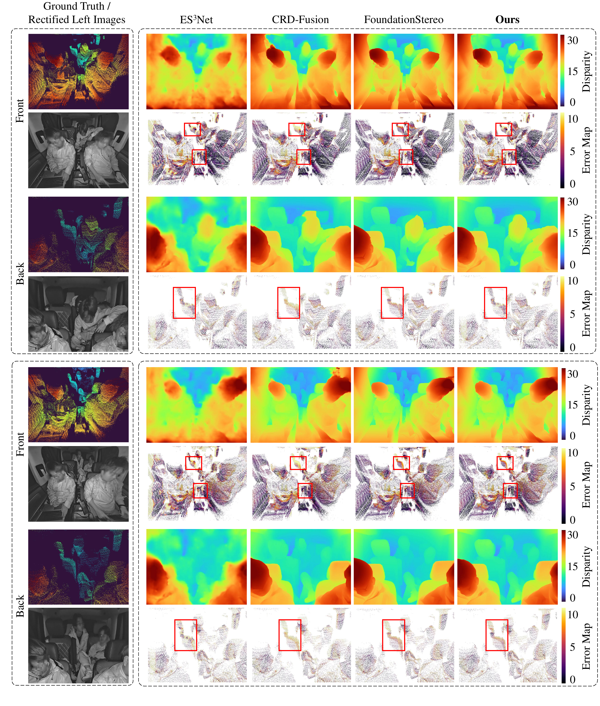

# Efficient and Robust In-Cabin Depth Estimation from Infrared Fisheye Stereo Cameras via Uncertainty-Aware Distillation

This repository hosts the project page for:

> Efficient and Robust In-Cabin Depth Estimation from Infrared Fisheye Stereo Cameras via Uncertainty-Aware Distillation

Code, data, and pretrained models are not publicly released at this stage.

## Abstract

Infrared fisheye stereo cameras are attractive for in-cabin perception because they provide a wide field of view and remain robust under challenging illumination. However, accurate depth estimation in real vehicle cabins is difficult: fisheye distortion breaks the assumptions of conventional stereo geometry, dense sub-pixel disparity annotations are hard to acquire in reflective and texture-less cabin regions, and practical deployment requires efficient inference on automotive edge platforms.

This work addresses these challenges with an efficient rectification and training pipeline for in-cabin infrared fisheye stereo depth estimation. A unified rectification mapping combines undistortion, epipolar rectification, and resolution resizing into one sampling operation, reducing repeated interpolation and preserving image quality. To train stereo matching networks in the target domain without dense manual disparity labels, an uncertainty-aware distillation strategy uses a stereo foundation model as the teacher and filters pseudo labels through a combined uncertainty estimation module. A real-world in-cabin infrared fisheye stereo dataset is further constructed to evaluate the method across diverse illumination conditions, seat configurations, and passenger poses.

## Overview

The proposed system targets practical in-cabin depth estimation from infrared fisheye stereo cameras. It combines geometry-aware preprocessing with uncertainty-aware pseudo-label learning to obtain accurate and efficient stereo depth predictions in real vehicle cabins.

  

  <em>Unified rectification mapping for infrared fisheye stereo images. The mapping integrates distortion removal, stereo rectification, and target-resolution resizing into a single sampling operation.</em>

## Method

### Unified Rectification Mapping

Conventional fisheye stereo preprocessing usually applies undistortion, stereo rectification, and resizing as separate steps. Each step introduces an additional image resampling operation, which increases runtime and can blur fine details. The proposed unified mapping precomputes the required transformations and generates rectified target images directly from the raw fisheye image pair through a single sampling operation.

### Uncertainty-Aware Distillation

The training strategy uses a stereo foundation model as a teacher to generate zero-shot disparity predictions for the target in-cabin domain. Since not all teacher predictions are reliable, the proposed combined uncertainty estimation module evaluates both static uncertainty cues from the matching distribution and dynamic uncertainty cues from iterative predictions. Reliable pseudo labels are selected to supervise a lightweight student stereo model.

  

  <em>Uncertainty-aware distillation. Teacher predictions are filtered with static and dynamic uncertainty cues before being used as pseudo labels for student training.</em>

## Dataset

We construct a real-world in-cabin infrared fisheye stereo dataset using a vehicle-mounted data acquisition system. The dataset covers diverse illumination conditions, seat configurations, and passenger poses, and provides real in-cabin scenes for evaluating depth estimation under practical automotive conditions.

  

  <em>Real-world in-cabin data acquisition setup and LiDAR-camera calibration pipeline for constructing evaluation data.</em>

## Qualitative Results

The proposed method produces smooth disparity maps while preserving cabin structures and passenger boundaries. Compared with unsupervised stereo methods and foundation-model predictions, the distilled student model achieves robust in-cabin depth estimation with improved efficiency for edge deployment.

  

  <em>Qualitative comparison on real in-cabin infrared fisheye stereo images.</em>

## Contributions

In summary, this article makes the following three contributions:

- A unified rectification mapping for fisheye stereo images that integrates undistortion, epipolar rectification, and resolution resizing into a single sampling operation.
- A UAD strategy for training stereo matching networks in the target in-cabin scenarios, where a stereo foundation model provides pseudo labels that are filtered by a CUE module.
- A real-world in-cabin infrared fisheye stereo dataset that covers diverse illumination conditions, seat configurations, and passenger poses.

## Repository Status

This repository is currently intended for project introduction only. Source code, dataset access, and trained model checkpoints will be announced separately.
